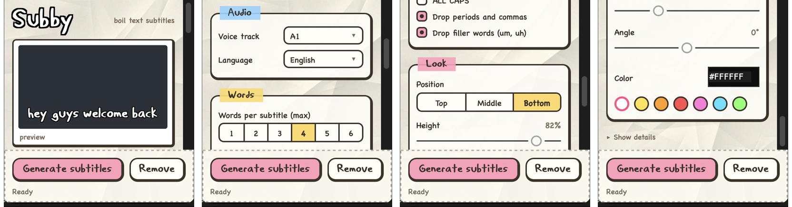

# Subby

*Work in progress.* A Premiere Pro panel for designing animated subtitles: it transcribes your sequence and lays
down styled "line boil" subtitle clips that you can then tweak one by one.

## What it does

- Transcribes the speech in your sequence with Premiere's built-in speech to text.
- Splits it into short subtitles that fit the frame, breaking at sentence ends and pauses.
- Places each one as its own animated title clip in my After Effects "boil" style, with the position, size, angle
  and color you set in the panel. **Remove** clears them again.

I built it for my own YouTube videos. It's tested on macOS with Premiere Pro 26.5.

## Installing

1. Download `Subby.ccx` from [Releases](../../releases) and double-click it. Creative Cloud asks you to confirm,
   because the plugin isn't from the Adobe marketplace.
2. Keep Premiere › Settings › Plugins › **Enable developer mode** switched on. Adobe lists it as required for
   plugins installed from a file.
3. Install the **Thunderman** font, which the subtitles use.
4. Restart Premiere, then open **Window › UXP Plugins › Subby**.

## Using it

1. Open your sequence. Your voice should be on **A1**. You can pick another track under Voice track.
2. Make sure the **top video track is empty** from where the talking starts. If every track is in use, add one
   first (Sequence › Add Tracks).
3. Press **Generate subtitles**.

The preview at the top of the panel shows how the subtitles will look. To fix a typo, select the subtitle clip and
edit **TEXT** in the Essential Graphics panel. **Remove** only removes clips Subby made, and Cmd+Z undoes it.

### Settings

| Setting | Default | What it does |
|---|---|---|
| Voice track | A1 | Which track's speech is transcribed |
| Language | English (US) | Premiere's transcription language |
| Words per subtitle (max) | 4 | 1–6. Lines that would be too wide get fewer words |
| ALL CAPS | off | |
| Drop periods and commas | on | `?` and `!` are kept |
| Drop filler words | on | um, uh |
| Position / Height | Bottom | Top, Middle, Bottom, or the Height slider |
| Size | 100% | 40–250% |
| Angle | 0° | −45° to 45° |
| Color | white | A swatch or a hex code |

Settings are remembered between sessions.

## Development

- `premiere-panel/` is the plugin. Load it with Adobe UXP Developer Tools and it shows up as **Subby Dev**, next to
  the installed copy.
- `python3 tools/package.py` builds `dist/Subby.ccx`.
- `node tools/test_chunk.js` checks how words are grouped into subtitles.
- [`CLAUDE.md`](CLAUDE.md) is the developer handover: how it works, what Premiere's plugin API can and can't do,
  and the test workflow. Subby is built with Claude Code, which reads that file.
